# System Architecture

`chandra-ocr-2-eval` evaluates how a resume matches a job description while preserving source
evidence and keeping every result as human-review decision support.

## 1. Problem

The project converts a JD and resume into structured, evidence-backed artifacts, evaluates mandatory
requirements and weighted rubric criteria, and produces JSON/CSV/HTML/Markdown reports. It is not an
automated hiring decision system.

## 2. Chandra OCR

Chandra converts scanned PDF pages into layout HTML. The pipeline writes page HTML, page metadata,
`document.json`, `source-map.json`, and `metadata.json`. The source map is the source of page/block
provenance.

## 3. Gemma

Gemma is used for JD structuring and resume structuring. Gemma output is always parsed and validated
before it becomes a project artifact. Deterministic post-processing makes JD rubric semantics safer.

## 4. Deterministic Operations

Ingestion, cache keys, OCR artifact validation, JD post-processing, safety filtering, date
normalization, eligibility, matching, component construction, scoring, completeness, gates, and
reports are deterministic.

## 5. LLM Operations

Only JD structuring and resume structuring use Gemma. OCR uses Chandra. Raw responses are disabled by
default.

## 6. JD Flow

`scripts/extract_jd.py` calls `structure_jd_document_file`. Text/DOCX/PDF ingestion creates an
`IngestedDocument`. Gemma or the mock extractor creates `StructuredJD`. `_postprocess_jd_rubric`
normalizes mandatory/preferred/adjacent classification and emits warnings.

Synthetic example:

```text
Must be proficient in PHP, Laravel and WordPress.
JavaScript experience is helpful.
```

The post-processor keeps PHP/Laravel/WordPress required and moves JavaScript out of required/core.

## 7. Resume Flow

`scripts/run_full_resume_ocr.py` can OCR a PDF. `scripts/structure_resume.py` reads OCR artifacts and
calls `structure_resume_from_ocr`. The result is `CandidateProfile` with source-backed evidence.
`build_scoring_safe_profile` removes personal/protected data from the scoring input.

## 8. Evidence References

Each `EvidenceRef` carries:

- source type;
- source document ID;
- page number;
- block index;
- bounding box;
- exact text;
- normalized text;
- status;
- notes.

The dedupe key is `(source_type, source_document_id, page_number, block_index, normalized_text or exact_text)`.

## 9. Safety Filtering

The scoring engine receives only `ScoringSafeProfile`. Names, emails, phone numbers, addresses,
photos, and protected traits are not part of scoring.

## 10. Experience

`calculate_experience_duration` parses month/year ranges and merges overlaps. `ExperienceQualification`
adds role/date/relevance evidence and is computed once per evaluation date. Eligibility and linked
criteria reuse it.

## 11. Eligibility

`evaluate_eligibility` evaluates mandatory requirements. It returns `EligibilityResult` with
requirement details, statuses, evidence, ambiguity, and explanations.

## 12. Rubric Criteria

`StructuredJD.scoring_rubric` owns criterion identity. Results preserve criterion ID, name, category,
weight, and linked requirement IDs.

## 13. Components

`_criterion_components` builds additive components from linked requirements, required skills,
preferred skills, source-declared adjacent skills, inferred adjacent skills, and dimensions. No
field is allowed to disappear because another field is present.

## 14. Evidence Matching

`match_terms` and `match_requirement` use normalized token/phrase boundaries, narrow aliases,
controlled equivalents, and conservative semantic patterns.

## 15. Component Classes

- Core: mandatory or required qualification.
- Preferred: helpful but lower-impact qualification.
- Adjacent: related/transferable evidence, never a mandatory substitute.
- Controlled equivalent: explicit in-scope substitute evidence for one owner.
- Evaluation dimension: dimension-specific soft-skill evidence.

## 16. Fractions

Component support is converted to one of `0`, `0.25`, `0.5`, `0.75`, or `1`. Weighted score is
`weight * fraction`.

## 17. Completeness

Completeness combines class-specific component support with date and OCR factors. Diagnostics expose
totals and supported counts for required, preferred, adjacent, controlled, and dimensions.

## 18. Gates

Mandatory `FAIL` or uncertainty affects recommendation and review status. Human review always
remains required.

## 19. Reports

JSON is canonical. CSV, HTML, and Markdown summaries consume `CandidateEvaluationReport` and
`component_assessment` rather than explanation prose.

## 20. Artifacts And Cache

Run directories contain `structured-jd.json`, `structured-resume.json`, `evaluation.json`,
`evaluation.csv`, `evaluation.html`, `run-summary.json`, `run-summary.md`, and `run-manifest.json`.
Stage cache keys include source content hashes, model identifiers, prompt versions, and stage
parameters.

## 21. Rerun One Stage Safely

- OCR-only: rerun `scripts/run_full_resume_ocr.py`.
- JD-only: rerun `scripts/extract_jd.py` to a versioned `structured-jd-*.json`.
- Resume structuring only: rerun `scripts/structure_resume.py` from existing OCR.
- Scoring only: rerun `scripts/evaluate_candidate.py` from existing structured JD/resume.
- Report only: rerun `scripts/build_report.py` from an evaluation JSON.

## 22. Debug Wrong Results

Check artifacts in this order: OCR metadata, OCR source map, structured resume evidence, structured
JD rubric, eligibility requirement details, component assessment, completeness diagnostics, reports.

## 23. Privacy

Leave `PIPELINE_DEBUG_RAW_RESPONSES=false` except for controlled debugging. Debug artifacts are safe
metadata unless raw debugging is explicitly enabled.

## 24. Known Limitations

The system is conservative and deterministic. It does not infer all possible equivalents. Soft-skill
matching intentionally misses weak signals. LLM structuring can vary, so deterministic
post-processing and warnings remain necessary.

## Diagrams

### A. System Context

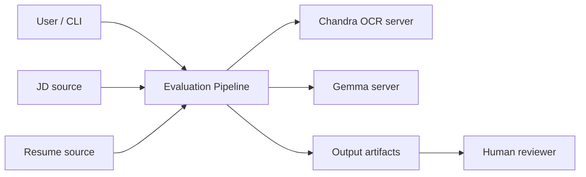

### B. End-To-End Data Flow

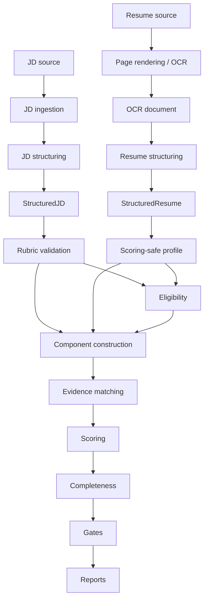

### C. Artifact Lifecycle

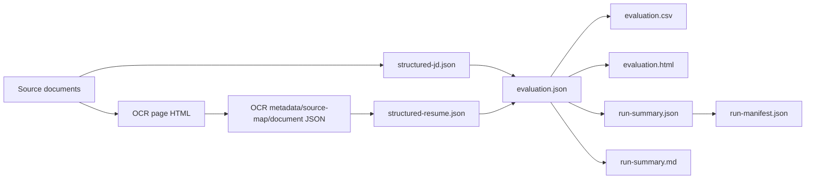

### D. JD Structuring

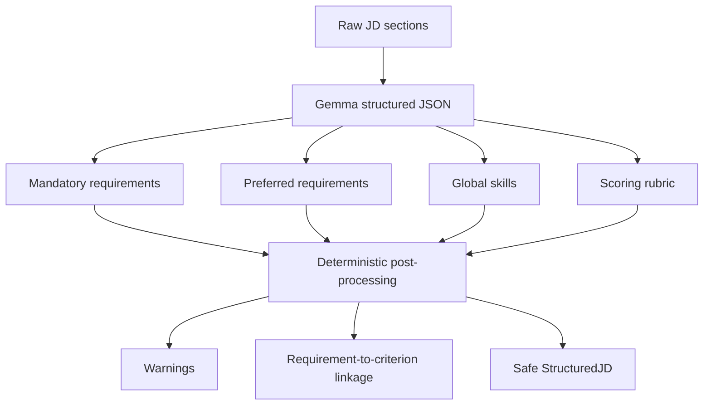

### E. Resume Structuring

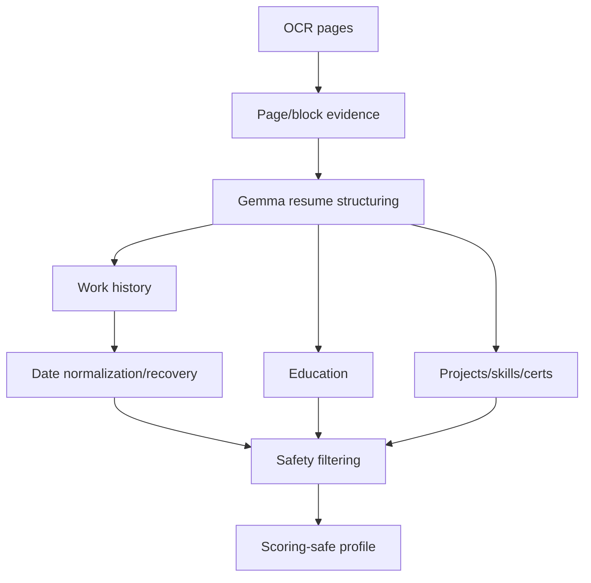

### F. Scoring Engine

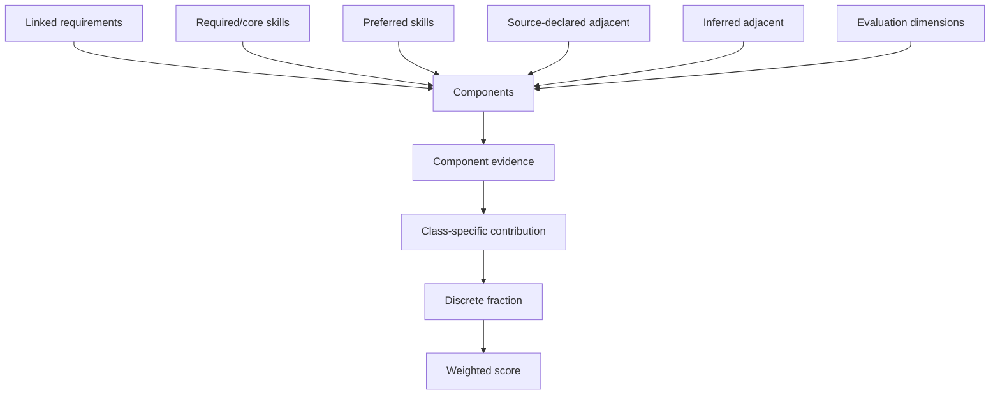

### G. Evidence Provenance

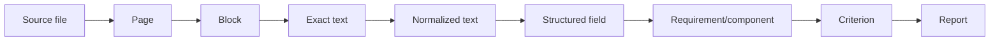

### H. Experience Calculation

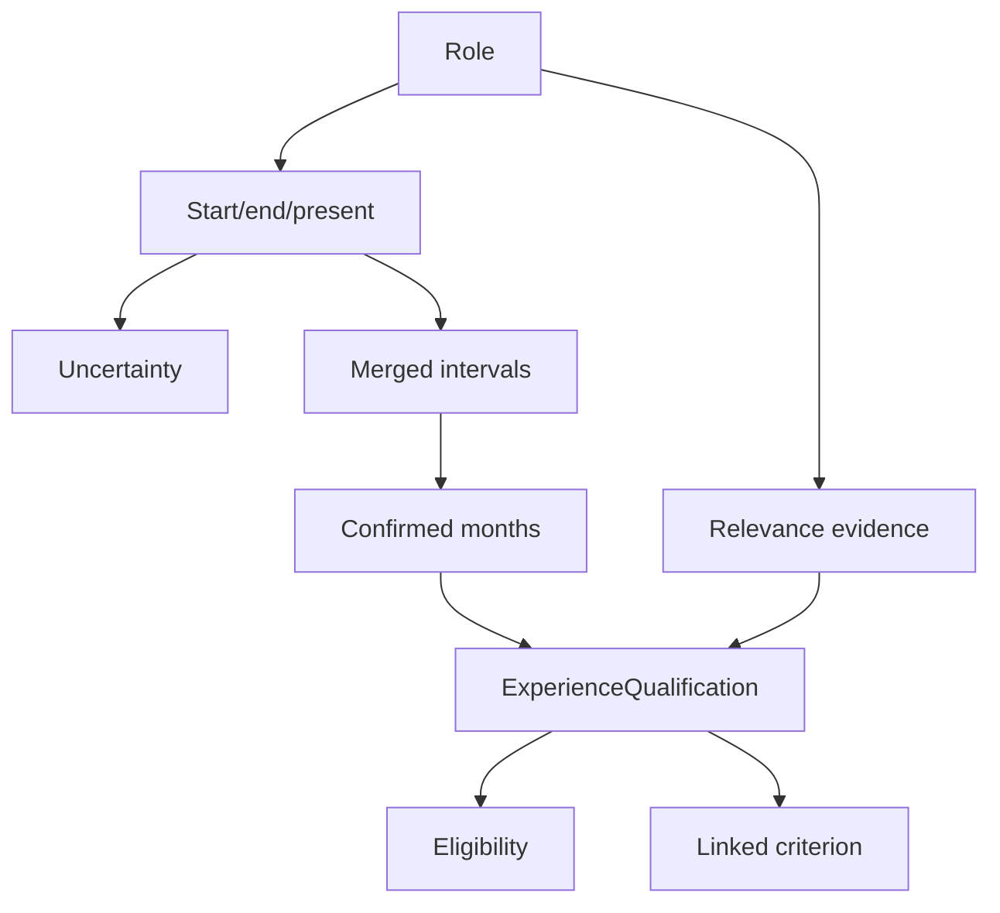

### I. Eligibility And Score Gates

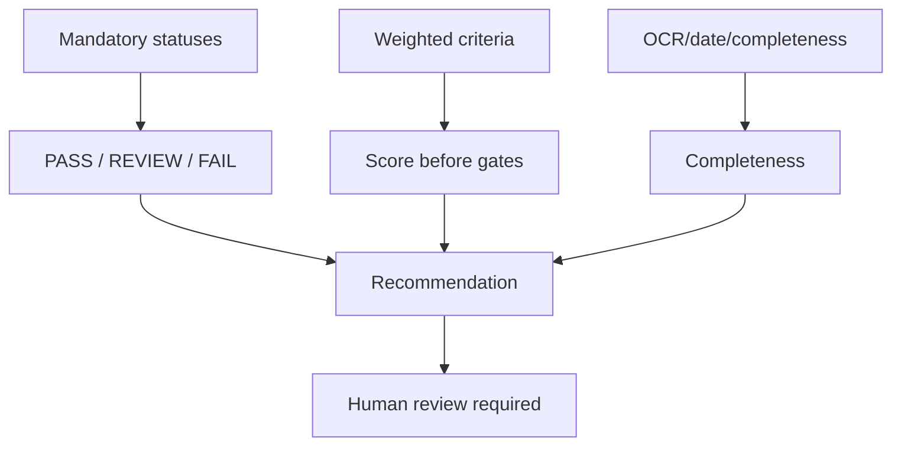

### J. `chandra-eval match` Sequence

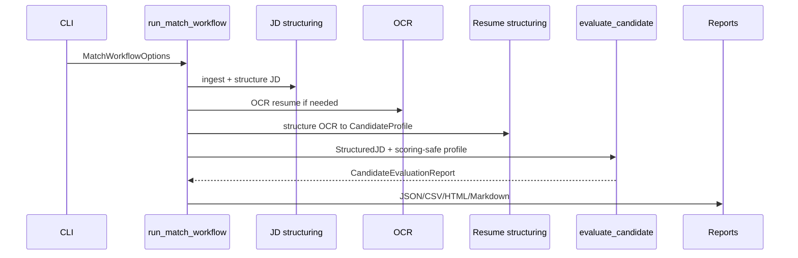

### K. Debugging Decision Tree

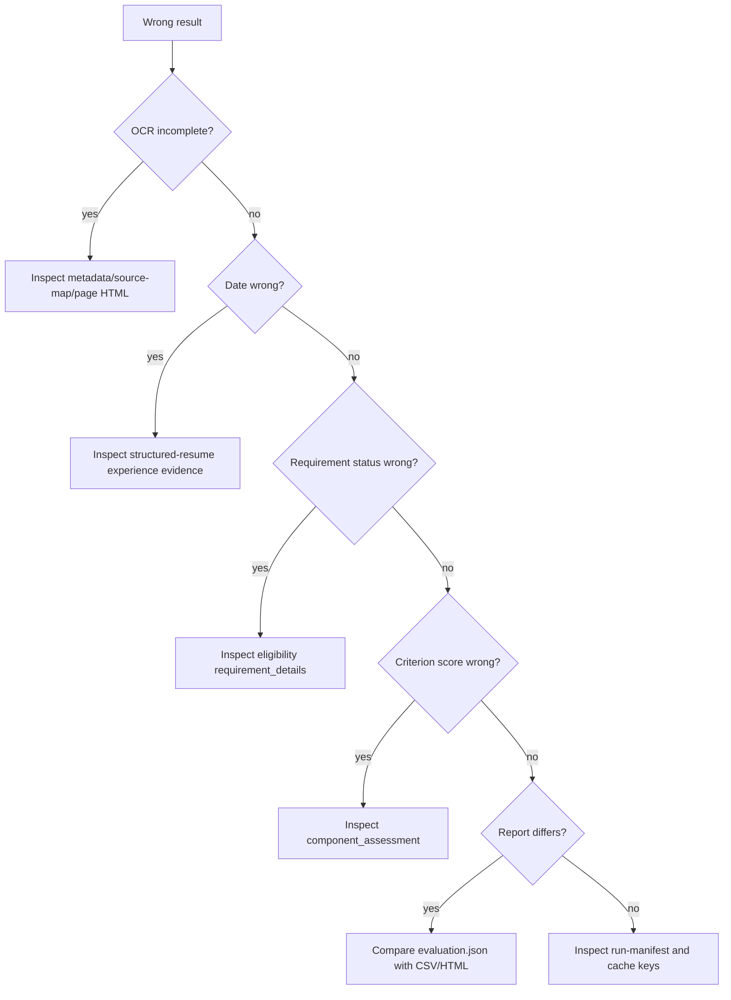
